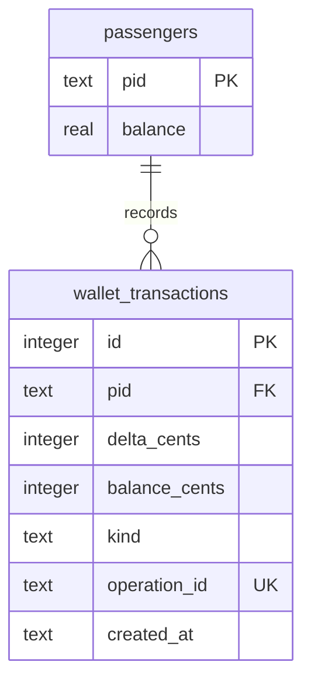

# Verification and design notes

Local Python 3.10 / Windows validation, 18 October 2026:

- 30 unittest tests passed: enrollment, money boundaries, migration, concurrent
  deduction/top-up, idempotency conflicts, SQL-trigger failure rollback, session/CSRF,
  logout socket disconnection, and boarding/exit/declined-fare flows.
- Browser demo: authenticated login, synthetic boarding, two stop advances, exit,
  20 fare and balance reduced from 80 to 60. The screenshot shows this actual run.
- `python demo.py` is a reproducible isolated example with a 100 starting balance.

## Schema



An injected trigger rejecting the ledger insert also rolls back the balance update
and an attempted passenger rename. Thirty simultaneous one-unit deductions against
a ten-unit wallet produce exactly ten successful charges. Forty concurrent 0.01
top-ups preserve both the persisted balance and the wallet service's shared cache.

## Deployment scope

The camera-free dependency set avoids TensorFlow and model downloads. Full camera
installation still uses `requirements.txt` and needs the detector and recognition
models. Real camera recognition, liveness detection, false-match rates, model download
availability and the full TensorFlow installation were not validated by these tests.

`Dockerfile.demo` provides a separate non-root simulation image:

```bash
docker build -f Dockerfile.demo -t facefare-demo .
docker run --rm -p 127.0.0.1:5000:5000 facefare-demo
```

The Docker recipe has not been built in this Windows validation run. The app and
SQLite ledger are a demonstrable prototype, not a payment system. Filesystem photo
changes and SQLite cannot share a single atomic transaction; rollback compensation
handles ordinary errors, but a process crash during photo management needs recovery.

Reference: [SQLite transactions](https://www.sqlite.org/lang_transaction.html).
